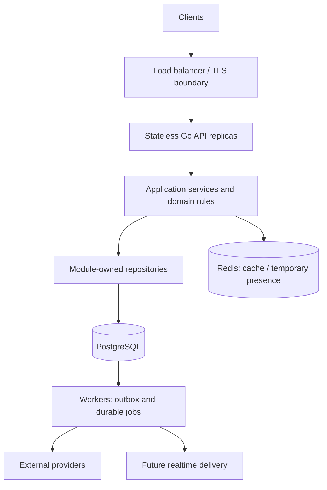

# Greenfield System Architecture

Status: Architecture baseline for review, derived from current `AGENTS.md` and owner direction. No business service is implemented. Module boundaries below are proposed and require feature-specific requirements before implementation.

## System boundary and stack

Build one Go domain-driven modular monolith. Compose the same application services into `cmd/api`, later `cmd/worker`, and later `cmd/realtime` only when their steps require them. Independent process replicas do not imply independent domain implementations or database ownership. No Django runtime, inherited schema or legacy adapter is required.

Use net/http and Chi, PostgreSQL with pgx v5/pgxpool and sqlc, Goose migrations, Redis for suitable temporary state, River for durable jobs, Docker Compose for isolated development dependencies, OpenAPI, slog and useful bounded-cardinality OpenTelemetry/Prometheus signals. Add and pin each dependency when introduced after checking compatibility. Do not invent unverified dependency versions.

This shows intended data flow; no load balancer, worker, Redis or provider integration currently exists.

## Code organization and dependency direction

| Location | Responsibility |
| --- | --- |
| `cmd/` | Composition roots, lifecycle and process startup; no business rules |
| `internal/platform/` | Configuration, HTTP plumbing, logs, connections, telemetry and infrastructure clients |
| `internal/modules/<domain>/` | Domain rules, application use cases, consumer-defined interfaces, transports and infrastructure adapters |
| `internal/shared/` | Only small, proven cross-domain primitives; no shared mutable business state |
| `database/migrations/` | Reviewed fresh-schema Goose migrations |
| `database/queries/` | Explicit sqlc input SQL, organized by owning module when introduced |
| `contracts/` | Reviewed OpenAPI and versioned event schemas |
| `tests/` | Cross-module contracts, integration, regression and load scenarios |
| `deployments/` | Development/staging deployment configuration when authorized |

Dependency direction: transport → application service → domain and repository interfaces. Infrastructure adapters implement those interfaces. Domain logic imports no HTTP, SQL, Redis or provider SDK. Constructors inject dependencies; no service locator, mutable globals, generic repository framework or circular module imports. sqlc persistence types do not become public DTOs.

## Proposed domain ownership

| Domain boundary | Owns | Collaborates through |
| --- | --- | --- |
| Identity | Credentials, verified identity, access/refresh sessions and recovery | Authenticated principal and explicit authorization interfaces |
| Profiles/social | Profiles, relationships and blocks | Identity references and moderation decisions |
| Authorization/moderation | Scoped privileges, resource access policy, enforcement and sensitive-action audit | Consumer-specific permission decisions; distinct account, business, room and entitlement roles |
| Wallet | Monetary balances, holds, ledger, settlement, idempotency and financial recovery | Typed application commands with a single financial write owner |
| Commerce/entitlements | Catalog, gifts, memberships, effects, reseller and purchase eligibility | Server-resolved quotes/snapshots; Wallet-owned settlement |
| Agency/hosting | Agency/host classification and approved live-time rules | Identity and live-session facts; Wallet for payouts |
| Rooms/realtime | Room state, seats, ownership, immutable live-session identity and recovery | Auth/entitlement checks and versioned events; future media adapter |
| Engagement | Leaderboards, Gift Chain, Fireworks, Rocket and games if approved | Committed domain facts; Wallet for every monetary effect |
| Messaging/feed | Messages, content, visibility and approved audit/retention behavior | Membership, blocks and moderation policies |
| Operations | Notifications, support and analytics; scoped admin application use cases | Owning-domain services; no privileged direct balance writes |

These are candidate ownership boundaries, not a mandate to create all packages now. Split or consolidate after requirements establish cohesive invariants. Cross-module reads use narrow interfaces or deliberate read projections. One module cannot independently write another module's tables. Shared database availability does not authorize bypassing an owner.

## Transaction and financial boundary

PostgreSQL is authoritative. Wallet owns all spending and monetary writes, including admin, games, gifts and reseller operations. The initiating use case resolves catalog price, recipients, eligibility, session and approved commission configuration server-side.

For atomic cross-domain settlement, the owning application use case coordinates one pgx transaction through an explicit internal unit-of-work boundary. Modules participate using transaction-scoped repositories; no independently committed subtransaction or arbitrary SQL access to another owner's tables. Validate and lock relevant mutable state inside this transaction with a documented global lock order; eligibility reads requiring consistency must not race with role/catalog changes. The concrete coordinator and lock order must be reviewed per operation before code.

The same transaction commits debit/credit, balanced append-only ledger, operation state, scoped idempotency result, required entitlement/order state and outbox records. Financial uniqueness and constraints live in PostgreSQL. No external network call occurs while a database transaction is open. External payouts use a committed pending intent, an idempotent worker/provider request, and a reconciled terminal transition; provider timeouts are ambiguous outcomes requiring status recovery, not automatic duplicate payment.

Whole diamonds use checked int64 arithmetic; fractional rates use exact arithmetic with approved per-operation rounding. Wire types, limits, rates, taxes, role eligibility and rounding remain undecided. Holds, lifetime counters and spendable balances are separate concepts. Ledger corrections use compensating entries. Cache is never spending authority.

## Events, durable jobs and multi-instance correctness

Commit critical events to a transactional outbox. A dispatcher may deliver more than once; consumers deduplicate by event/operation reference and persist results atomically with effects. River provides durable jobs when introduced; specify retries, backoff/jitter, recovery ownership and failed-job inspection. Coordinate periodic jobs across replicas. Do not claim exactly-once delivery.

Events carry an event ID, version/type, aggregate/session ID, revision or stream sequence, UTC timestamp and minimal payload. Specify ordering per aggregate, not globally. Reconnect uses authorized snapshots and replay/revision checks; a room ID is not a live-session ID. Redis Pub/Sub can accelerate ephemeral delivery but provides no critical replay guarantee.

HTTP instances are stateless; sessions and idempotency survive process loss. Temporary connection maps are local only. Future realtime fanout must reach each instance serving authorized subscribers; test missed messages, duplicates, stale revisions and reconnection to another instance. No correctness dependency on sticky sessions, process-local scheduler locks or process-local financial deduplication.

## Resource and failure controls

One bounded pgxpool per process. Budget connections across maximum API, worker and realtime replicas plus migration/operations reserve against the PostgreSQL connection limit. Keep transactions short with timeouts/cancellation; measure pool wait and lock contention. Define pool sizes from measured workload and deployment budget, not arbitrary defaults.

Bound request bytes, query results, pagination, goroutines, work queues, outbound payloads and retries. Use explicit SQL projections, stable keyset orderings and indexes derived from predicates/joins. No per-row provider calls or unbounded default counts. Profile before optimizing; p95 ≤200 ms is a target, not a measured result.

Cache keys are versioned with TTL/invalidation after commit and stampede control. Cache outage falls back only where correct and bounded; coordination/authorization failure must not become fail-open privilege or double spending. Separate evictable cache from coordination needs. Apply backpressure when workers or clients are slow.

Liveness measures process viability; readiness measures ability to serve required work and becomes false during draining. Dependency failures must not trigger restart storms via liveness. Shutdown stops admission, drains bounded work and safely relinquishes jobs/connections; committed pending work remains recoverable.

## Security and observability

Validate identity server-side; use short-lived access tokens and rotating/revocable refresh sessions under a reviewed policy. Session revocation semantics and provider selection require identity design. Derive actor identity from authenticated context. Deny resource access by default, enforce ownership/scoped admin permissions and audit sensitive actions.

Use TLS at the approved edge and trusted proxy configuration, least-privilege credentials, secret injection, upload validation and provider signature/replay checks over required raw bytes. Never log tokens, credentials, raw sensitive payloads or private profile data. Request IDs must be bounded/validated and are correlation values, not authorization.

Measure latency percentiles, throughput/errors, SQL count/time/rows, CPU/RSS/allocations, pool wait, network bytes, queue age/depth, outbox lag and reconciliation failures. Labels must have bounded cardinality; user IDs, room IDs and request IDs do not become metric labels. Keep telemetry access restricted.

## Deferred seams and unresolved decisions

Document future ports for media token issuance, room operations, node health and cluster registry; create no speculative interfaces/packages yet. No LiveKit SDK/configuration, SFU routing, server provisioning or admin registration implementation belongs to this step.

Before feature implementation, approve identifier/wire amount types, role policies, financial rules, session lifetimes, retention/privacy requirements, provider contracts, availability objectives and expected workloads. See the feature matrix, database design, API standards and testing strategy. Reference source gaps block affected business decisions, not foundation work.
